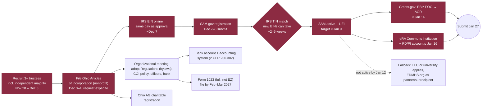

# EDMHS.org: nonprofit formation and transition plan

*Prepared 2026-11-27. Decision: **EDMHS.org applies to CDC RFA-CE-27-013 as a nonprofit.** ICT, PMSG education and other community training move to EDMHS.org. EDM Health Services, LLC keeps the technology and clinical products (KATA, NABS, consulting).*

> This is an operational checklist, not legal or tax advice. Fees, forms and processing times change, so confirm each item marked **[confirm]** with the Ohio Secretary of State, the IRS and SAM.gov, and have an Ohio nonprofit attorney or CPA review the Articles, Regulations and related-party arrangements before filing.

---

## 1. Recommendation summary

1. **Yes, make the nonprofit the long-term home for ICT and community education.** Funders for youth violence prevention, community health and training (CDC, OCJS, SAMHSA community grants, local foundations) expect a mission-locked nonprofit. Many foundations fund only 501(c)(3) organizations.
2. **501(c)(3) status is *not* required for this CDC application.** The forecast lists "Nonprofits non-higher education *without* 501(c)(3)" as eligible. The critical path is **Ohio incorporation → EIN → SAM.gov UEI → Grants.gov + eRA Commons**. File Form 1023 in parallel; it does not gate February 1.
3. **Keep a firewall between the nonprofit and the LLC.** Dr. Hall would lead the nonprofit *and* own the LLC that supplies KATA, so every payment from the nonprofit to the LLC is a related-party transaction (see §5). Handle it openly, with a conflict-of-interest policy, disinterested board approval and at-cost pricing, or it can threaten both tax exemption and the grant.
4. **Set a fallback decision date: January 12, 2027.** If SAM.gov has not activated the nonprofit's registration by then, submit with **EDM Health Services, LLC** as applicant (UEI FSMJREGJGPJ3 is already active) and EDMHS.org as the named community partner. Alternatively, a university partner can apply with EDMHS.org as subrecipient. The applicant cannot be changed after submission without CDC approval.
5. **Separate the infrastructure now:** a new GitHub organization, a new Google Cloud/Firebase project with its own billing, and the edmhs.org domain held by the nonprofit. Clean separation makes cost allocation, audit and any later Single Audit straightforward.

---

## 2. Critical path to a fundable applicant (target dates)

| # | Step | Detail | Target |
|---|---|---|---|
| 1 | **Board** | Ohio nonprofit corporations generally need at least three trustees **[confirm ORC 1702.26]**. Recruit a majority who are *independent*: not employed by or financially tied to the LLC. Good fits: a community member from the corridor, a nonprofit finance or CPA professional, an educator or youth-services leader, and (later) a Youth Advisory Council liaison. | Dec 3 |
| 2 | **Name check** | Search "Empowered Disease Management Health Services" on Ohio Business Central. Consider legal name **"EDMHS.org, Inc."** or **"Empowered Disease Management Health Services Foundation"** so it is clearly distinct from the LLC. | Dec 1 |
| 3 | **Articles of Incorporation, nonprofit** | Ohio SOS Form 532B, filed online, with a statutory agent. Include the 501(c)(3) purpose and dissolution clauses in §3. Request expedited processing **[confirm fee and turnaround]**. | Dec 3–4 |
| 4 | **EIN** | IRS online EIN application for the new corporation (responsible party: an officer). | Same day as approval |
| 5 | **SAM.gov** | Register the entity (all awards, financial assistance). Legal name and physical address must match the Ohio filing and IRS records **exactly**. **Risk:** IRS TIN matching for a brand-new EIN can lag by weeks. Start immediately and keep the IRS EIN confirmation letter (CP 575) to upload if validation stalls. | Submit Dec 7–8; active ≤ Jan 9 |
| 6 | **Grants.gov** | Login.gov account, then link to the organization. The EBiz POC (set in SAM) assigns the AOR role. | ≤ Jan 14 |
| 7 | **eRA Commons** | Institution registration by the Signing Official, then a PD/PI account for Dr. Hall. NIH and CDC advise allowing several weeks for all registrations. | ≤ Jan 16 |
| 8 | **Organizational meeting** | Adopt the Code of Regulations (bylaws), the conflict-of-interest policy (IRS Form 1023 sample policy), and whistleblower and document-retention policies. Elect officers: President, Treasurer, Secretary. The Treasurer should not be the PI. | Within 1 week of incorporation |
| 9 | **Bank and accounting** | A separate bank account, plus an accounting system able to track federal funds by award, time and effort, and allowable costs (2 CFR 200.302–303). | Dec 2026 |
| 10 | **Form 1023 (full)** | Form 1023-EZ is **not** available: projected gross receipts exceed $50,000 per year. File the full Form 1023 on Pay.gov **[confirm current fee]**. Filed within 27 months of incorporation, exemption is retroactive to the incorporation date. | Feb–Mar 2027 |
| 11 | **Ohio Attorney General** | Charitable registration (ORC 109.26) and annual filings **[confirm]**. | Within 6 months |
| 12 | **Policies required by federal awards** | Written procurement standards (2 CFR 200.318–327), financial management, conflict of interest, and a **PHS Financial Conflict of Interest policy** (42 CFR 50 Subpart F applies to PHS-funded research, CDC included). Investigators must disclose significant financial interests, which includes Dr. Hall's ownership of the LLC. | Before submission (FCOI) |
| 13 | **Insurance** | General liability plus abuse and molestation coverage for youth programs; directors and officers coverage. | Before programming transfers |

---

## 3. Required clauses for the Articles (IRS 501(c)(3) organizational test)

Adapted from IRS Publication 557. Have counsel confirm the wording.

**Purpose:**
> The corporation is organized exclusively for charitable, educational and scientific purposes within the meaning of Section 501(c)(3) of the Internal Revenue Code, including, for such purposes, the prevention of youth violence, community health education, training and research, and the making of distributions to organizations that qualify as exempt organizations under Section 501(c)(3).

**Limitation:**
> No part of the net earnings of the corporation shall inure to the benefit of, or be distributable to, its trustees, officers or other private persons, except that the corporation is authorized to pay reasonable compensation for services rendered and to make payments and distributions in furtherance of its purposes. The corporation shall not carry on activities not permitted to be carried on by an organization exempt under Section 501(c)(3), and shall not participate in any political campaign on behalf of or in opposition to any candidate for public office.

**Dissolution:**
> Upon dissolution, assets shall be distributed for one or more exempt purposes within the meaning of Section 501(c)(3), or to the federal, state or local government for a public purpose.

---

## 4. Moving ICT from edmhs.us to EDMHS.org

| Item | Today | Target | How |
|---|---|---|---|
| Program owner | "a program of EDM Health Services, LLC" (ict.edmhs.us footer, partners page) | "a program of EDMHS.org, in partnership with Soul City Wrestling and Boxing Clubs" | Update the wording **after** incorporation is approved. Until then, keep the current text or use "transitioning to EDMHS.org". |
| Domain | `ict.edmhs.us` (Firebase project `edmhs-web`) | `ict.edmhs.org`, with `ict.edmhs.us` permanently redirecting (301) | Add the custom domain in the new Firebase project and keep the old site serving a redirect. |
| Hosting project | `edmhs-web` (LLC billing) | New `edmhs-org` Google Cloud project (nonprofit billing) | `deploy/bootstrap_gcp.sh`. Move the ICT hosting site after edmhs.org is live. |
| Source | `dah512/ict-site` | Nonprofit GitHub organization | Transfer the repository (GitHub keeps redirects) once the org exists. |
| Participant data | KATA (LLC platform) | Nonprofit is the **data owner**; LLC is a processor under a data-processing agreement / BAA | Sign the agreement before any enrollment data is collected under the nonprofit. |
| Curriculum IP | Created by Dr. Hall | License or assign to the nonprofit (royalty-free for nonprofit use) | Short written license. This avoids private-benefit questions. |
| Soul City partnership | Informal | MOU with the nonprofit | Becomes a letter of support for CDC. |

---

## 5. Related-party safeguards (nonprofit ↔ LLC)

- **Disclose** Dr. Hall's ownership of the LLC to the board, in the Form 1023, in the CDC budget justification (subaward to the LLC) and under the PHS FCOI policy.
- **Recuse:** Dr. Hall does not vote on any contract with the LLC. A disinterested board majority approves it, using comparability data (what other vendors charge for similar services), and minutes record the decision. This follows the IRS rebuttable presumption procedure.
- **At cost, no fee:** federal awards bar profit to for-profit subrecipients anyway (2 CFR 200.400(g)). Document the cost basis for KATA hosting and support.
- **Consider a license instead of a subaward:** a no-cost or at-cost license of KATA to the nonprofit, with hosting in the nonprofit's own cloud project, simplifies compliance and is easier to explain to reviewers.
- **Compensation:** Dr. Hall's salary as PI or Director must be reasonable, set by the independent trustees, and charged to the grant only at the effort actually worked (time-and-effort records).

---

## 6. Things only you (or the board) can do

These need a person's identity, signature or payment, so they cannot be automated:
- Recruit the trustees, sign and file the Articles, and pay the state fee.
- Apply for the EIN (responsible-party attestation), and complete SAM.gov, Login.gov and eRA identity verification.
- Open the bank account; bind insurance.
- Buy or confirm the **edmhs.org** domain and add the DNS records Firebase gives you.
- Create the GitHub organization and repository, and the Google Cloud billing account.
