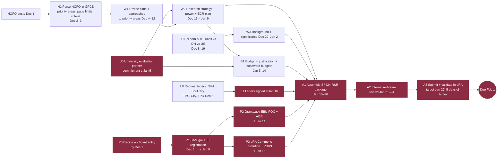
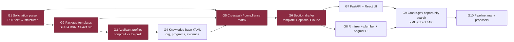
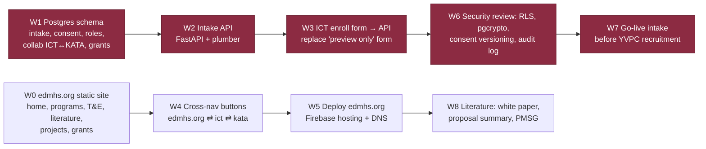
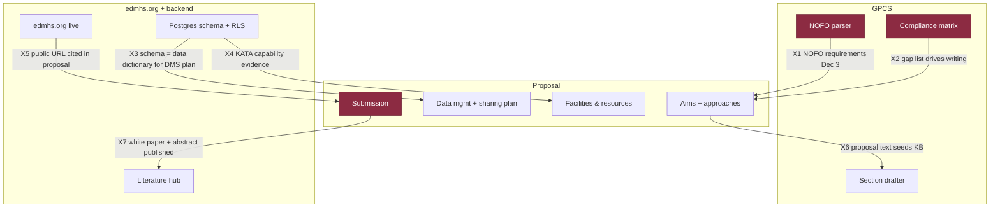
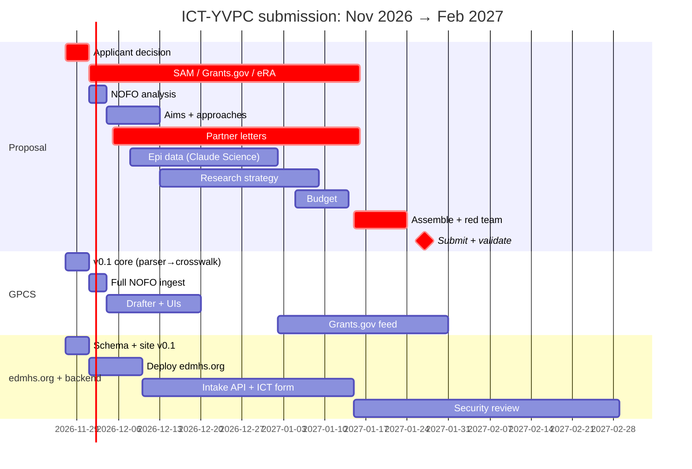

# Milestones and critical paths

Today: **2026-11-27**. Hard deadline: **CDC RFA-CE-27-013 due 2027-02-01** (forecast). Three workstreams:

- **P**: Proposal (draft → submission)
- **G**: Grant Proposal Creation System (GPCS)
- **W**: edmhs.org site, plus the shared Postgres backend for ict.edmhs.us and kata.edmhs.us

On the diagrams, a ★ or a red node marks the critical path. Any slip on it moves the submission date.

---

## 1. Proposal critical path (P)

The longest chain is **entity registration → Grants.gov/eRA accounts → validated submission**. Writing is *not* the critical path; registration and partner letters are.

### Proposal milestones
| ID | Milestone | Owner | Due | Done when |
|---|---|---|---|---|
| P-M1 | Applicant entity decided (Option A/B/C) | Dr. Hall | **2026-12-01** | Written decision; SAM registration started |
| P-M2 | NOFO parsed; compliance matrix generated (GPCS) | GPCS | 2026-12-03 | Every NOFO requirement mapped to a section |
| P-M3 | University evaluation partner committed | Dr. Hall | **2027-01-05** | Signed letter of intent + named co-I |
| P-M4 | Specific Aims page final | PI + co-I | 2026-12-12 | Red-team reviewed |
| P-M5 | Epidemiology section with Lucas/OH/US comparisons | Data | 2027-01-02 | All [DATA] tags resolved |
| P-M6 | SAM active; Grants.gov + eRA roles active | Admin | **2027-01-16** | Test login + AOR confirmed |
| P-M7 | All letters of support received | Engagement | **2027-01-16** | PDFs in package |
| P-M8 | Budget and subaward budgets final | Admin | 2027-01-14 | Ties to ≤ $1.2M |
| P-M9 | Package assembled; red-team complete | All | 2027-01-24 | Score ≥ "Excellent" on mock review |
| P-M10 | Submitted and validated | AOR | **2027-01-27** | eRA Commons shows no errors |

---

## 2. GPCS critical path (G)

| ID | Milestone | Due | Done when |
|---|---|---|---|
| G-M1 | Parser, templates, profiles, crosswalk working, tested in Python and R | **2026-11-30** (this session: v0.1) | `pytest` and `testthat` pass on RFA-CE-27-013 |
| G-M2 | Parses full NOFO PDF (posted Dec 1) | 2026-12-03 | Page limits, criteria and priority areas extracted |
| G-M3 | Drafter produces every SF424 R&R narrative section from the KB | 2026-12-10 | Section stubs with gap list |
| G-M4 | React UI (Python) and Angular UI (R) hit parity | 2026-12-20 | Same crosswalk output from both stacks |
| G-M5 | Grants.gov search and ingest (Search2 API / XML extract) | 2027-01-31 | Daily matched-opportunity feed |
| G-M6 | Second proposal generated end-to-end (e.g. SAMHSA, OCJS, HRSA) | 2027-03-15 | Submitted or in review |

---

## 3. edmhs.org + shared backend critical path (W)

| ID | Milestone | Due | Done when |
|---|---|---|---|
| W-M1 | Schema + seed run on Postgres 16 | **2026-11-30** (v0.1) | `psql -f` clean; RLS policies on |
| W-M2 | edmhs.org pages built with nav to and from ICT and KATA | 2026-11-30 (v0.1) | Static site served by container |
| W-M3 | edmhs.org deployed and DNS live | 2026-12-10 | https://edmhs.org resolves |
| W-M4 | ICT enroll form posts to the intake API (consent workflow on) | 2027-01-15 | End-to-end test with synthetic child |
| W-M5 | Security review + penetration test | 2027-03-01 | Findings closed |
| W-M6 | Intake live for YVPC recruitment | 2027-09-30 | Matches award start |

---

## 4. Inter-connection points

These are tasks where one workstream blocks another. They are the places to watch.

| ID | Interconnect | From → To | Needed by |
|---|---|---|---|
| X1 | NOFO requirements extracted | GPCS → Proposal | 2026-12-03 |
| X2 | Compliance and gap matrix | GPCS → Proposal | Weekly from Dec 4 |
| X3 | Schema data dictionary → Data Management & Sharing Plan | Backend → Proposal | 2027-01-09 |
| X4 | KATA/ICT platform demo → Facilities & Resources | Backend → Proposal | 2027-01-09 |
| X5 | edmhs.org live (credibility, public program page) | Site → Proposal | 2027-01-15 |
| X6 | Final proposal text → knowledge base for future proposals | Proposal → GPCS | 2027-02-01 |
| X7 | White paper + abstract → literature hub | Proposal → Site | 2027-02-05 |

## 5. Gantt (all workstreams)

